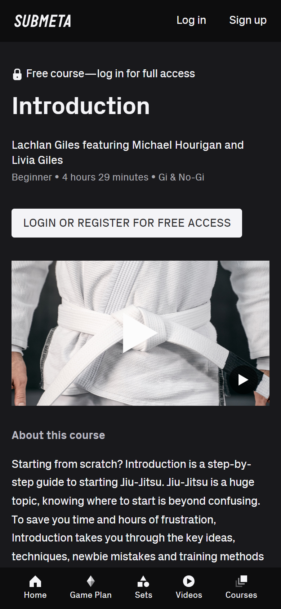
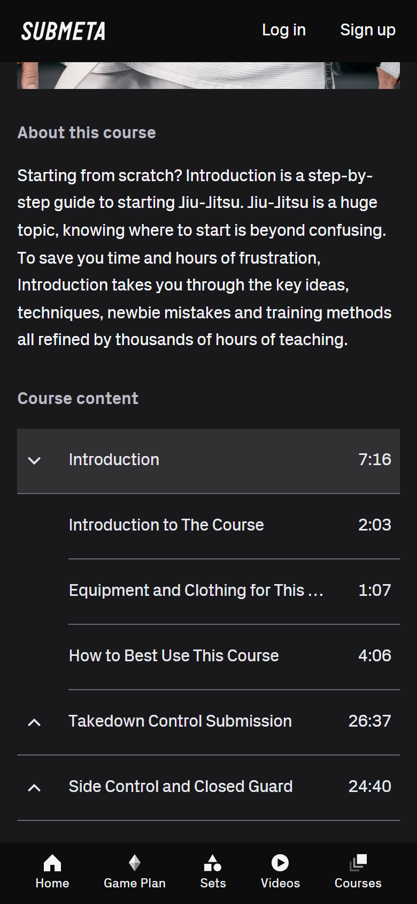
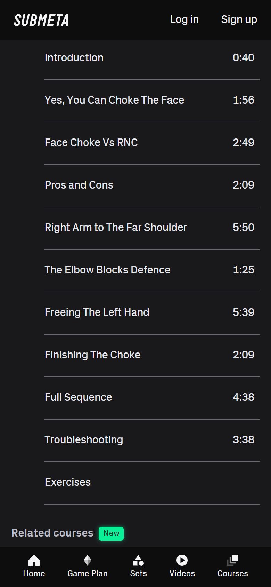
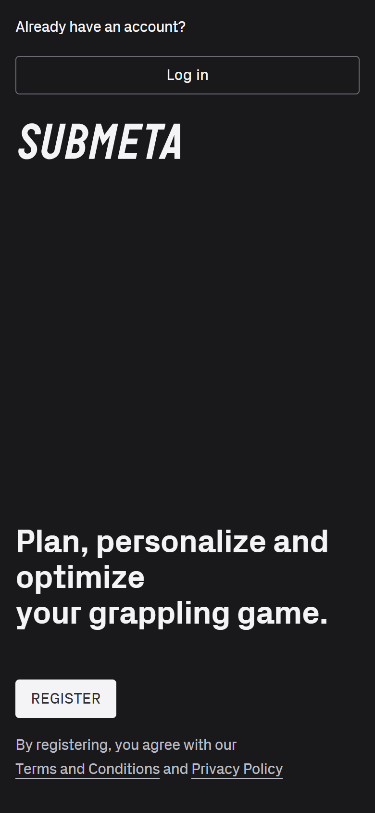

## Sezione 6 — Evidenze da Navigazione Live Web App

**Data:** 6 novembre 2026. **Stato: appendice parziale**, con cinque screenshot reali di Submeta. Le funzioni non raggiunte non vengono presentate come osservazioni. Nessuna nuova analisi degli screenshot App Store e nessuna modifica al codice applicativo.

### 6.1 Metodo, provenienza e limiti

Letti il report precedente, `docs/architecture.md`, `skill-practice/docs/ui-system.md` e il codice corrente dei quattro componenti richiesti. Le specifiche di seguito distinguono **osservato live**, **dichiarato dal sito ufficiale** e **proposta FESK**.

Navigazione in Chrome per Windows, Device Toolbar **Responsive, 390 × 844 CSS px, Device type Mobile**, con emulazione touch. È emulazione di viewport/input, non una prova su Safari iOS o dispositivo fisico. Chrome mostrava il viewport ridotto con “Fit to window”: le coordinate del desktop non sono coordinate CSS del telefono.

Le immagini sono esportazioni native di Chrome tramite **Capture screenshot**, senza ritaglio, ricostruzione o modifica: **780 × 1687 pixel** ciascuna. Il viewport impostato è 390 × 844; l'export presenta una scala circa 2× e un arrotondamento verticale di un pixel. Non sono file bitmap 390 × 844. Per visualizzarle nel formato di lettura mobile, impostare la larghezza a 390 px nel documento di destinazione, conservando le proporzioni. Gli originali sono mantenuti come evidenza.

I conteggi dei tap partono dallo stato indicato ed escludono navigazione mediante URL, consenso cookie e scroll, riportati separatamente. Posizione rispetto al pollice: valutazione euristica su un telefono tenuto in verticale, non misura di usabilità con persone. Orientativamente, il terzo inferiore è più raggiungibile; non è una regola universale né sostituisce un test sul campo.

| Area richiesta | Copertura effettiva | Cosa resta aperto |
| --- | --- | --- |
| Submeta: corso gratuito e indice | Aperta preview pubblica di Introduction; espanso un capitolo; aperto anche Face Choke | Player completo delle lezioni dopo login |
| Submeta: Troubleshooting | Riga osservata nell'indice pubblico di Face Choke | Interazione didattica dentro la lezione |
| Submeta: Recall Quizzes | Non raggiunti | Domanda visiva, selezione, errore, conferma, retry e riepilogo |
| Submeta: Game Plan | Toccata voce della bottom navigation; ritorno alla landing pubblica | Stato vuoto, aggiunta contenuti, avanzamento, corso completato |
| dojoHUB | Aperte home e pagina prodotto `/app`; lette informazioni e disponibilità della demo Kata | Video demo non avviato; nessun filtro Tatami o step Kata manipolato |
| budoo Campus | Verificati riferimenti ufficiali con lettura web, senza ispezione mobile completata | Tour e gestione collezioni live |
| Tonebase e STEEZY | Individuati percorsi ufficiali verso lezioni gratuite/catalogo con lettura web | Player mobile e Practice Plan non manipolati |

**Interruzione tecnica:** l'accesso diretto alle schede browser risultava indisponibile. È stato usato Chrome tramite Computer Use; quest'ultimo ha poi interrotto le azioni perché non riusciva a determinare con sufficiente certezza l'URL corrente su Windows. Nessun'altra azione UI è stata eseguita dopo l'interruzione. Questo limite è distinto dai gate di autenticazione dei siti.

### 6.2 Submeta — indice mobile e progressiva esposizione dei contenuti

Fonte: [corso Introduction](https://submeta.io/@lachlangiles/courses/introduction).

**Osservato live.** Il corso è dichiarato gratuito ma l'accesso completo richiede login. La pagina pubblica espone titolo, autori, livello, durata totale, contesto Gi/No-Gi, CTA di accesso, preview visiva e descrizione. Non equivale a una lezione autenticata gratuita già utilizzabile.

In mobile il logo e gli accessi account stanno in alto. Cinque destinazioni rimangono nella barra inferiore: home, piano, set, video e corsi. La barra consente di cambiare contesto senza tornare all'inizio della pagina; è vicina al pollice, mentre gli accessi account richiedono un allungamento verso l'alto. Nelle catture l'header e la bottom navigation restano visibili durante lo scroll.

**Struttura effettivamente vista:** corso → capitoli espandibili → righe di lezione. L'indice di Introduction presenta dodici capitoli, inizialmente chiusi nello stato visitato. Ogni intestazione ha chevron a sinistra, titolo e durata aggregata a destra. Il primo capitolo contiene tre video; dopo un tap compaiono le relative righe indentate. La prima lezione dura 2:03; la durata del capitolo è 7:16. Il capitolo successivo rimane chiuso: la struttura permette quindi di esporre un gruppo senza aprire tutto il corso.

Il tap sull'intestazione modifica lo stato locale della lista, senza cambio pagina. Un successivo tap sulla prima riga di lezione non ha avviato una lezione né prodotto una navigazione osservabile. Nell'albero accessibile pubblico le lezioni risultavano elementi di lista, mentre il capitolo era un disclosure. Non conteggiare questo percorso come “due tap al video”.

| Interazione | Tap osservati | Micro-UX e limite |
| --- | --- | --- |
| Esporre le tre lezioni del primo capitolo | 1 dall'indice chiuso, dopo scroll | Intestazione larga; titolo e durata separano orientamento e costo temporale |
| Toccare la prima lezione pubblica | 1 aggiuntivo | Nessun player completo aperto; non emerge un feedback di accesso dalla riga toccata |
| Passare al Game Plan | 1 dalla bottom navigation | Accesso comodo al pollice, ma visitatore anonimo rimandato all'ingresso |

**Criticità osservabili:** alcuni titoli lunghi sono troncati con ellissi; non abbiamo verificato una modalità per leggerli interamente. La descrizione prima dell'indice richiede scroll. Non compare nell'indice pubblico una percentuale di completamento né una spunta di lezione completata: non sappiamo come siano resi dopo login.

**Interpretazione progettuale:** il pattern trasferibile è la lista gerarchica poco profonda con costo temporale visibile, non la costruzione di un grafo didattico. La reperibilità di una lezione breve può aiutare il ripasso mirato; questa sessione non misura un miglioramento dell'apprendimento.

### 6.3 Submeta — Troubleshooting, esercizi e confine dei quiz

Fonte: [corso Face Choke](https://submeta.io/@lachlangiles/courses/face-choke).

**Osservato live.** Nel corso visitato il singolo capitolo si presenta aperto. La riga **Troubleshooting**, durata **3:38**, segue il riepilogo dell'esecuzione ed è allo stesso livello delle altre lezioni. Non è visualizzata come ramo annidato di un albero di errori. Subito dopo compare **Exercises**, senza durata visibile. Le righe usano lo stesso asse di lettura e separatori orizzontali; nessun badge d'errore o trattamento di allarme distingue il troubleshooting.

Questo è un dettaglio nuovo rispetto agli screenshot App Store già analizzati: la correzione degli errori è rintracciabile nel percorso dei contenuti. Non dimostra che ogni corso abbia la stessa struttura o che la riga sia generata in risposta a un errore dell'allievo.

**Recall Quizzes: non verificati.** Non è stato aperto un quiz, né osservato un video fino alla fine in una sessione autenticata. La presenza di Exercises non dimostra che sia un quiz di richiamo visivo post-video. Restano ignoti:

- formato della domanda e numero di opzioni;
- relazione temporale con la fine del video e possibilità di saltare;
- invio immediato al tap oppure conferma separata;
- feedback per errore/correttezza, spiegazione e nuovo tentativo;
- effetti sul completamento del corso.

Non esistono screenshot di questi stati in questa appendice. Nessuna schermata è stata ricostruita per colmare il vuoto.

### 6.4 Submeta — Game Plan e accesso anonimo

Fonte: [Game Plan](https://submeta.io/gameplan), raggiunto tramite la voce nella barra inferiore del corso.

**Osservato live.** Un tap sulla voce Game Plan ha riportato a `https://submeta.io/`, con accesso account in alto e registrazione nella parte bassa. Questa schermata è un **gate anonimo**, non lo stato vuoto di un piano. Il layout privilegia la CTA di registrazione vicino al fondo; non esplicita nel corpo della pagina che l'utente era entrato dal Game Plan.

Le catture S6-01 e S6-04 sono identiche nei pixel esportati: documentano la coincidenza della destinazione visibile, non due pattern diversi. Non sono stati osservati aggiunta al piano, selezione obiettivi, ripresa dal punto interrotto o stato completato.

**Proposta FESK:** un eventuale accesso a un piano non configurato dovrebbe spiegare perché è vuoto e fornire un'azione pertinente. Non copiare il redirect anonimo come comportamento di un piano vuoto.

### 6.5 Altri siti — risultati preliminari, non evidenze di interazione nel prodotto

Questa sottosezione riporta soltanto ciò che la verifica ufficiale ha stabilito. Non attribuisce conteggi di tap o ergonomia ai flussi non utilizzati e non dispone di screenshot mobile esportati per questi siti.

**dojoHUB.** Sono state aperte live la home e [la pagina prodotto](https://dojohub.app/app). La pagina espone una demo video di kata completo e immagini delle viste dell'app; il video non è stato avviato. Il sito descrive un controllo a mezza velocità che mantiene l'impostazione passando tra gli step e un nuovo menu Tatami. Non sono stati manipolati quei controlli nell'app: la loro posizione mobile e il numero di tap restano ignoti. La pagina distingue video selezionati gratuiti e accesso completo agli step riservato agli abbonati. **Nessuna nuova analisi delle immagini già presenti nel report precedente.**

**budoo.one.** Il percorso richiesto `/campus` non era leggibile con lo strumento web; questo non prova che sia indisponibile in ogni browser. La fonte ufficiale trovata è [eLearning Campus](https://budoo.one/elearning-campus): descrive raccolte per argomento e destinatari, unità con materiali diversi e rilascio progressivo dei moduli. È descrizione commerciale, non gestione collezioni provata live. [La demo](https://budoo.one/demo) richiede dati di registrazione e attivazione dell'account; non è stato richiesto un account. Nessuna conclusione nuova su filtri o player mobile.

**Tonebase.** [Le lezioni gratuite di pianoforte](https://www.tonebase.co/piano/lessons) collegano una [lezione pubblicizzata come gratuita](https://app.tonebase.co/piano/courses/free/penelope-roskell-the-pillars-of-piano-technique-pt) nell'app. Il percorso è stato individuato con lettura web, senza esecuzione del player mobile. La pagina ufficiale menziona piani di pratica tra le funzionalità: non è stata raggiunta una preview interattiva del Practice Plan. Non affermiamo che non esista.

**STEEZY.** La [pagina ufficiale](https://www.steezy.co/) descrive cambio vista, loop, specchio, velocità e sezioni; i link di categoria portano al [catalogo web](https://app.steezy.co/results/categories/hip-hop/classes). Non è stato aperto un player mobile operativo. Le descrizioni confermano la funzione pubblicizzata, non l'interazione: nessun nuovo conteggio di tap e nessun aggiornamento agli screenshot statici già coperti.

### 6.6 Specifiche concrete per FESK Practice

Queste sono **proposte**, non feature implementate né risultati di test con allievi. La priorità è rendere il ripasso e la registrazione più diretti con il modello dati corrente.

#### A. `VideoPlayer.tsx` — visibilità del contenuto e strumenti essenziali

**Baseline verificata:** props `videoUrl` e `title`; stato locale pre-play → iframe YouTube; placeholder per URL non valido. Nessun indice, stato di avanzamento o callback di completamento.

1. **Pre-play:** mantenere un solo riquadro 16:9 con titolo e azione di riproduzione accessibile. Se si aggiunge una copertina, prevedere fallback locale in caso di errore; non caricare la IFrame API prima dell'interazione solo per mostrare un'immagine. Una miniatura remota prima del tap anticipa la richiesta a YouTube: valutarne esplicitamente l'impatto sul comportamento privacy attuale.
2. **Durata:** non chiamare automaticamente “durata video” `estimated_duration_seconds`: il nome del campo non prova che misuri il filmato anziché l'esercizio. Verificarne il significato prima di mostrarlo sul player; nessuna durata inventata dal client.
3. **Due video della stessa skill:** un solo player montato. Riutilizzare `SegmentedNav` con selezione tramite URL della pagina server, preservando un unico `href` per variante. Il componente corrente è basato su link e `active`: non accetta `value/onValueChange`. Evitare di descriverlo come toggle locale già pronto. Per un toggle locale isolato usare `Button` secondari/outline senza creare una nuova primitiva; selezione esplicita, etichette dai campi reali, niente deduzioni automatiche del ruolo.
4. **Velocità, solo dopo aver scelto di adottare la YouTube IFrame API:** SDK ufficiale senza pacchetto wrapper; chiedere al player le velocità disponibili, offrire solo quelle supportate e disabilitare l'azione finché il player non è pronto. In un successivo cambio video mantenere la preferenza di velocità soltanto se supportata. È una proposta coerente con la descrizione ufficiale dojoHUB, non un controllo provato live.
5. **Specchio:** non applicare `scaleX(-1)` all'intero iframe operativo: specchierebbe anche testo e controlli del player. È un limite da risolvere e verificare su YouTube mobile prima di promettere la funzione. Non consegnare un mirror apparentemente gratuito che compromette i controlli nativi.
6. **Capitoli e loop A–B:** non introdurli nel primo intervento. Le skill correnti non espongono timestamp di capitoli; non creare tabelle, editor o albero generico per imitare Submeta. Un eventuale loop richiede verifica del lifecycle del player, validazione A < B e pulizia dei timer: non è un semplice cambio estetico.

**Accettazione:** dalla preview pronta, 1 tap avvia il tentativo di riproduzione; nessuna garanzia di autoplay su tutti i browser. Selezione variante: 1 tap. Errori del provider non devono essere confusi con URL non valido; mantenere disponibile la registrazione pratica anche se il video non funziona. Vedere un video non segna automaticamente la skill come praticata.

#### B. `TodaySkillCard.tsx` — ripasso su richiesta, contatore sempre reperibile

**Baseline verificata:** Server Component con video 16:9 sempre presente, nota del maestro e contatore/azione pratica. Il completamento deriva da `alreadyDoneToday` oppure raggiungimento del target di ripetizioni.

- Mantenere `<Card>`, nome italiano, nota breve e azioni di pratica visibili; collocare il contatore dopo il contenuto essenziale, prima di eventuali dettagli estesi. La posizione sullo schermo varia con lo scroll: nessuna promessa che ogni azione sia sempre nel terzo inferiore.
- Mettere il video dentro un disclosure locale chiuso di default, con etichetta “Ripassa il video”. Un `
/
` può gestire apertura locale senza convertire l'intera card in Client Component. Per montare il player soltanto all'apertura, usare un piccolo componente client locale al dominio, non un nuovo sistema di accordion.
- Obiettivi: **1 tap** per mostrare il video, **1 tap aggiuntivo** per avviarlo se la preview resta separata. Non presentare apertura e playback come un unico tap già ottenuto.
- La nota del maestro può ospitare un promemoria su un errore frequente solo se scritto dal docente: è il trasferimento leggero del pattern Troubleshooting. Non generare automaticamente errori o diagnosi.
- Stato completato: spunta, testo e `completedButtonClassName` già condivisa per il bottone. Non trasformare il completamento in una nuova CTA gold. Non collassare improvvisamente la card che contiene il focus o spostare la pagina dopo una mutazione; offrire una riapertura esplicita se viene introdotta una variante compatta.
- Stato senza video: azione di pratica utilizzabile e messaggio breve; nessun riquadro vuoto obbligatorio. Stato di salvataggio: controllo temporaneamente occupato e feedback testuale; al fallimento conservare dati e possibilità di riprovare tramite i meccanismi di mutazione esistenti.

**Accettazione:** provare cinque skill con nomi lunghi, note e target diversi a 390 × 844. Misurare altezza e scroll reali; non promettere che cinque card entrino necessariamente in una sola schermata. Apertura video e completamento devono essere azioni separate.

#### C. `SkillListItem.tsx` — riga identificabile e destinazione chiara

**Baseline verificata:** il link principale contiene nome, grado e minuti; `name_italian` non è reso. Il menu stato è un controllo separato. Esiste anche un secondo link a chevron verso la stessa skill.

- Aggiungere `name_italian` sotto il nome e, quando presente e pertinente, il contesto solo/coppia dal valore reale di `practice_mode`; non inferirlo dal titolo.
- Lasciare la durata in una colonna/area metadata stabile, dichiarandola tempo stimato di pratica finché non è provata un'altra semantica. Evitare `0 min` per durate inferiori al minuto: usare un formato leggibile coerente.
- Obiettivo: **1 tap dalla riga al dettaglio**; target del menu separato almeno 44 × 44 CSS px. Non annidare bottoni nel link né rendere la modifica di stato un effetto collaterale dell'apertura della skill.
- Preservare il nome completo nel nome accessibile. Permettere due righe per titoli lunghi se necessario: non copiare il troncamento forte visto nell'indice pubblico Submeta.
- Non aggiungere progressi percentuali del corso alle skill: i dati correnti di pratica non rappresentano il consumo video o la padronanza tecnica.

**Accettazione:** nomi italiani lunghi, durata assente/breve, skill senza video e stato modificabile non devono sovrapporre titolo e controlli. Il menu non deve portare al dettaglio per errore.

#### D. `PracticeCalendar.tsx` — leggere la pratica senza inventare progresso didattico

**Baseline verificata:** heatmap a 90 giorni, celle non interattive con `title`; `PracticeDay` espone soltanto `{ date, practiced }`. Il `title` non è un'interazione touch affidabile. Il componente non conosce numero di esercizi, minuti o percentuale di sessione.

- **Primo intervento senza nuovi dati:** conservare la heatmap come riepilogo e aggiungere un collegamento `Button variant="outline"` al calendario operativo `/calendar`. **1 tap** apre quella pagina; non promettere che selezioni automaticamente un giorno se la route non supporta già quel contratto.
- Se si richiede l'ispezione quotidiana direttamente qui, usare un dettaglio inline con data e stato testuale oppure una vista mensile con target adeguati. A 390 px, circa tredici/quattordici colonne di settimane non possono contenere celle da 44 px: aumentare soltanto il target invisibile creerebbe sovrapposizioni. Non rendere cliccabili novanta microcelle fingendo di aver risolto l'ergonomia.
- Per una futura vista interattiva, rimuovere la semantica `role="img"` dal contenitore dei controlli, usare bottoni etichettati e annunciare il dettaglio selezionato; selezione e apertura del giorno vanno distinguibili anche senza colore.
- **Intensità: rinviata.** La query attuale legge già log recenti, ma l'aggregazione scarta i conteggi. Un'estensione richiederebbe DTO e funzione di aggregazione aggiornati e un test significativo. Il conteggio delle skill praticate può essere calcolato dai log esistenti; la “sessione completa” richiede confronto con il piano e non è sinonimo di volume alto.
- Stato vuoto: “Nessuna pratica registrata negli ultimi 90 giorni” con percorso verso l'allenamento. Giorno senza attività: testo neutro. Nessuna equivalenza tra giorno praticato, video visto e tecnica acquisita.

Queste specifiche correggono due assunzioni troppo rapide del report precedente: i livelli di intensità non sono già disponibili nelle props del calendario e i microtarget della heatmap non diventano accessibili solo sostituendo un `div` con un `button`.

### 6.7 Vincoli visuali e architetturali di accettazione

| Decisione | Applicazione obbligatoria |
| --- | --- |
| Superfici | `--surface-base` per pagina, `<Card>` per contenuti/controlli, data card esistente per `/progress`, `surface-inset` per note incassate |
| Azioni | Una primaria `Button default` per intent; azioni ripetute secondarie/outline; niente glow aggiunto localmente |
| Filtri | `ChipButton`/`chipClassName` da `primitives/Chip.tsx`; attivo `border-primary bg-primary/10 text-primary` |
| Contesti esclusivi | `SegmentedNav` con superficie attiva card/foreground, mai gold pieno; rispettare il suo contratto a link |
| Completamento | Classe condivisa `src/lib/ui-classes.ts`; testo e icona oltre al colore; non percentuale di padronanza |
| Styling interattivo | Colori strutturali, radius e focus/stati nelle primitive esistenti o classi condivise; non duplicarli nei componenti di dominio |
| Architettura | Letture server nelle query esistenti; mutazioni attraverso le azioni esistenti; stato UI locale solo dove serve; nessun nuovo storage primario browser |
| Scope | Nessuna dipendenza, libreria video, LMS, grafo corsi, tabella quiz o motore di raccomandazione introdotto da questa ricerca |
| Estrazioni | Pattern locali finché non esistono almeno tre callsite reali, secondo `ui-system.md`; nessuna modifica manuale a `components/ui/` |

**Ordine suggerito:** (1) disclosure video e migliore densità di Today, (2) nome italiano e leggibilità delle righe, (3) percorso touch dal riepilogo pratica al calendario, (4) un solo player per variante. Velocità, mirror, loop e quiz restano interventi separati con verifica dedicata.

### 6.8 Verifiche mancanti per chiudere l'appendice live

1. Submeta, in una sessione autorizzata già disponibile: eseguire una lezione completa; catturare domanda di recall, errore, conferma, retry e ritorno al corso. Contare separatamente tap di risposta e di conferma.
2. Game Plan: catturare piano vuoto, aggiunta, ripresa e completamento; distinguere obiettivi di apprendimento, visione e pratica.
3. dojoHUB: avviare la demo ufficiale; verificare se esiste un tour pubblico realmente interattivo di Tatami e dei singoli step; non usare immagini promozionali per dedurre tap.
4. Campus: verificare il percorso pubblico attuale e l'eventuale tour; la richiesta di un nuovo account demo non è stata effettuata.
5. Tonebase/STEEZY: aprire i percorsi già individuati e verificare controlli reali del player e disponibilità del piano senza iniziare abbonamenti.

Per ciascuno: screenshot prima/dopo, URL, punto di partenza, tap, scroll, persistenza e stati vuoti/completati. Fino a quelle verifiche questa appendice resta parziale.
